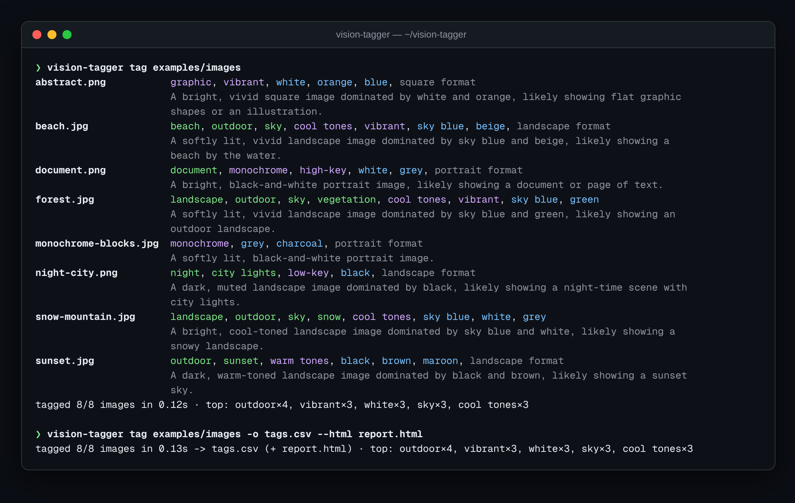
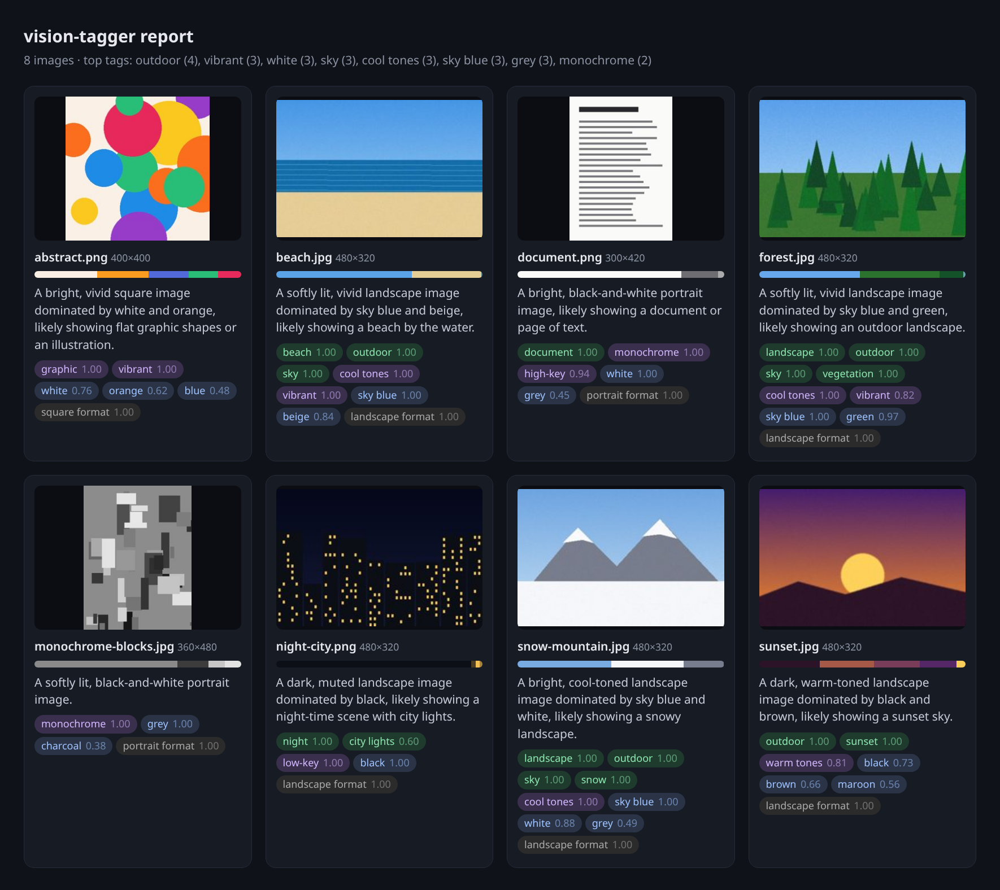

<div align="center">

# 🏷️ vision-tagger

**Batch image auto-tagging and captioning: explainable classical computer vision offline, an optional vision-LLM when you want richer captions.**

[](https://github.com/hbtabi/vision-tagger/actions/workflows/ci.yml)


-412991?logo=openai&logoColor=white)

[](LICENSE)

</div>

Photo libraries, CMS uploads and dataset folders all need tags and alt text. **vision-tagger** points at a folder
and produces JSON / CSV / an HTML contact sheet with **tags, confidence scores, dominant colours and a caption**
for every image.

The default engine is **classical computer vision written with NumPy and Pillow** — colour science in CIE Lab,
k-means palettes, Sobel edges, entropy and region statistics feeding transparent rules — so it is fast, offline and
fully explainable (`vision-tagger inspect` shows every number behind every tag). Add `--vision-llm` to caption with
GPT-4o-mini, LLaVA on Ollama, or any OpenAI-compatible vision model while keeping the measured colour data.

## 📸 Demo

<p align="center"></p>

The HTML contact sheet (`--html report.html`):

<p align="center"></p>

Sample outputs: [`examples/tags.csv`](examples/tags.csv) · [`examples/tags.json`](examples/tags.json) · [`examples/report.html`](examples/report.html)

## ✨ Features

- **Scene tags** — sky, vegetation, water, beach, sunset, snow, night, city lights, document, landscape, outdoor
- **Style tags** — monochrome, vibrant, high-key, low-key, high contrast, minimal, detailed, graphic, warm/cool tones
- **Dominant colours** via seeded k-means++ in CIE Lab, named against a 28-colour palette, with hex codes and shares
- **Confidence scores** from soft thresholds, so `--min-score` filtering is meaningful
- **Captions** generated from the strongest signals ("A bright, cool-toned landscape image dominated by sky blue and white, likely showing a snowy landscape.")
- **Batch CLI** with recursive folder scanning, thread-pool workers, EXIF orientation, alpha handling and per-file error rows
- **Exports**: table, JSON, JSONL, CSV and a self-contained HTML contact sheet
- **Optional vision-LLM**: caption + tags from any OpenAI-compatible chat endpoint; heuristics take over on any failure
- **Procedural sample images** (`vision-tagger samples`) so demos and tests need no downloaded photos

## 🚀 Quick start

```bash
git clone https://github.com/hbtabi/vision-tagger.git && cd vision-tagger
python -m venv .venv && source .venv/bin/activate
pip install -e ".[dev]"

vision-tagger tag examples/images                          # pretty table
vision-tagger tag ~/Pictures -r -o tags.csv --html report.html
vision-tagger tag photo.jpg -f json --features             # include raw features
vision-tagger inspect examples/images/sunset.jpg           # every feature + score
```

### With a vision-LLM (optional)

```bash
export OPENAI_API_KEY=sk-...
export OPENAI_BASE_URL=https://api.openai.com/v1     # or http://localhost:11434/v1 for Ollama
export VISIONTAGGER_MODEL=gpt-4o-mini                # or llava, llama3.2-vision, ...
vision-tagger tag ~/Pictures --vision-llm -o tags.json
```

## 🔬 How the classical engine works

| Signal | How it is computed | Used for |
| --- | --- | --- |
| Brightness, contrast | Mean / std of Rec. 709 luma | high-key, low-key, night, captions |
| Colourfulness | Hasler & Süsstrunk opponent-colour metric | monochrome, vibrant, graphic |
| Edge density | Share of pixels with Sobel magnitude > 0.5 | minimal, detailed, document |
| Entropy | Luma histogram entropy (bits) | minimal, graphic |
| Region masks | HSV masks for blue, green, warm, dusk, white, dark, sand — per top / bottom third | sky, water, beach, sunset, snow… |
| Palette | k-means++ in CIE Lab, nearest named colour by ΔE | colour tags, swatches, captions |

Each rule is a product of soft ramps, e.g. `sky = ramp(blue_top, 0.15, 0.5) × (1 − ramp(edges, 0.25, 0.45))`,
which yields a 0–1 confidence instead of a hard yes/no. It won't recognise a cat — that is what `--vision-llm` is for —
but it is honest, fast (~15 ms per image) and great for colour search, alt-text drafts and dataset triage.

## 🗂️ Project structure

```
vision-tagger/
├── src/visiontagger/
│   ├── colours.py      # sRGB→Lab, HSV, named palette, k-means++
│   ├── features.py     # luma, colourfulness, Sobel edges, entropy, region masks
│   ├── tagger.py       # soft-threshold rules, scores and captions
│   ├── vision_llm.py   # optional OpenAI-compatible vision captioning + merge
│   ├── batch.py        # discovery, thread pool, JSON/JSONL/CSV/HTML exporters
│   ├── samples.py      # procedural sample images
│   └── cli.py          # vision-tagger tag | inspect | samples
├── examples/           # sample images and generated outputs
├── tests/              # pytest suite
└── .github/workflows/ci.yml
```

## 🧪 Development

```bash
pytest && ruff check .
```

## 🛣️ Roadmap

- [ ] Optional ONNX CLIP backend for zero-shot labels without an API
- [ ] Perceptual-hash duplicate detection
- [ ] Face/person-count heuristics with privacy-preserving defaults
- [ ] Write tags back to XMP/IPTC metadata
- [ ] Watch-folder mode for CMS uploads

## 📄 Licence

[MIT](LICENSE) © 2026 Mohammed Hassan bin Tayyeb · Built by [Hasenix](https://github.com/hbtabi) in London.
